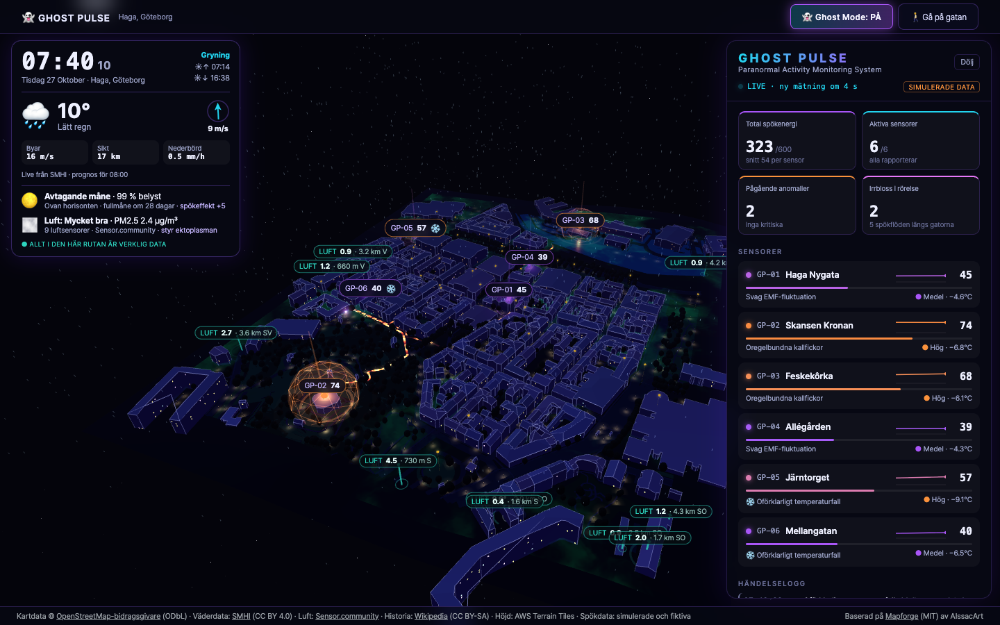

# 👻 GHOST PULSE – Paranormal Activity Monitoring System

En levande 3D-spökkarta över Haga i Göteborg, byggd som en Halloween-demo av hur man kan
visualisera data i en egenbyggd digital tvilling – med öppen kartdata, öppen realtidsdata
och AI som utvecklingsassistent.



> **Verklig data** (turkos i gränssnittet) blandas med **fiktiv spökdata** (lila/orange).
> Det står alltid tydligt vad som är vad.

## Vad man ser

| Lager | Källa | Typ |
|---|---|---|
| Byggnader, tak, gator, träd, spårväg, lyktor, kaféer | OpenStreetMap | Verklig |
| Terräng (Skansen Kronan på sitt berg) | AWS Terrain Tiles | Verklig |
| Väder: regn, snö, dimma, moln, vind, sol | SMHI (live) | Verklig |
| Luftsensorer (PM2.5/PM10) | Sensor.community (live) | Verklig |
| Historiska platser | Wikipedia | Verklig |
| Månens läge och fas | Beräknad | Verklig |
| Spöksensorer, irrbloss, spökflöden | Simulering i webbläsaren | **Fiktiv** |
| Varulvsdetektor (ljudsensor) | Simulering – styrd av verklig måne och vind | **Fiktiv** |
| Gastar | Dekoration | – |

Funktioner: Ghost Mode, gåläge på gatunivå (WASD/klick), handhållen spökmätare,
klickbara hus med historia och "vad finns i huset", händelselogg, syntetiskt varulvsylande.

## Kom igång lokalt

```bash
npm install
npm run dev            # http://localhost:5173
```

Tester (körs utan nätverk, Node 24+):

```bash
npm run test:sim       # spöksimulering, irrbloss, flöden, varulvsdetektor
npm run test:weather   # SMHI-tolkning, sol
npm run test:streets   # gatunätet i Haga
npm run test:walk      # kollision i gåläget
npm run test:opendata  # måne, luftsensorer, Wikipedia
```

## Publicera med Coolify

Appen är helt statisk (ingen backend, inga API-nycklar). Den byggs till en liten
nginx-image med `Dockerfile` och `nginx.conf` i repot:

1. Lägg koden i ett eget GitHub-repo.
2. I Coolify: **New Resource → Application → (Private/Public) Git repository**.
3. Välj repot och grenen, **Build Pack: Dockerfile**, port **80**.
4. Ange domän (t.ex. `ghostpulse.dindomän.se`) och tryck **Deploy**.

Testerna körs i bygget – går något sönder publiceras det inte. Hälsokontroll: `/healthz`.

Prova imagen lokalt: `docker build -t ghost-pulse . && docker run -p 8080:80 ghost-pulse`
→ http://localhost:8080

## Så byggdes det

- **Grund:** [Mapforge](https://github.com/stonyp/mapforge) (MIT) – React, TypeScript, Vite,
  Three.js och React Three Fiber. Mapforge hämtar OSM-data och bygger 3D-geometri.
- **Utvecklat med Claude Code** som AI-utvecklare: tak från OSM-taggar, procedurella fönster
  och kullersten, terräng, väder, gåläge, simuleringsmotor och gränssnitt.
- **Blender via MCP:** stadsmodellen exporterades som GLB, gjordes kusligare i Blender
  (upplysta fönster, nattmaterial, pumpor, namngivna sensorpositioner) och lästes in igen.
  Se [blender/README.md](blender/README.md).

## Så fungerar spökdatan

`src/ghost/simulation.ts` genererar nya mätvärden var femte sekund:

- **Energi** = platsens grundnivå + långsam våg + "spöktimme" + brus + händelser.
- **Grundnivån** höjs av verklig historia (Wikipedia-platser i närheten) och månljus.
- **Händelser** (temperaturfall, ektoplasma, skuggrörelse, viskningar, manifestation)
  ger kraftiga utslag och kan sprida sig till grannsensorer.
- **Irrbloss** vandrar längs de verkliga gatorna mot heta sensorer och höjer energin där de passerar.
- **Varulvsylanden** blir vanligare ju fullare den verkliga månen är; vinden från SMHI ger mikrofonbrus.

Datakällan ligger bakom ett gränssnitt (`GhostDataSource`) och kan bytas mot ett riktigt API.

## Licenser och källor

- Kod: MIT (Mapforge © stonyp/AIssacArt, tillägg i samma licens)
- Kartdata © [OpenStreetMap-bidragsgivare](https://www.openstreetmap.org/copyright) (ODbL)
- Väder: [SMHI](https://www.smhi.se/data) (CC BY 4.0)
- Luft: [Sensor.community](https://sensor.community) (ODbL/DbCL)
- Historia: [Wikipedia](https://sv.wikipedia.org) (CC BY-SA 4.0)
- Höjddata: [AWS Terrain Tiles](https://registry.opendata.aws/terrain-tiles/)

Originalets README finns i [docs/MAPFORGE-README.md](docs/MAPFORGE-README.md).
